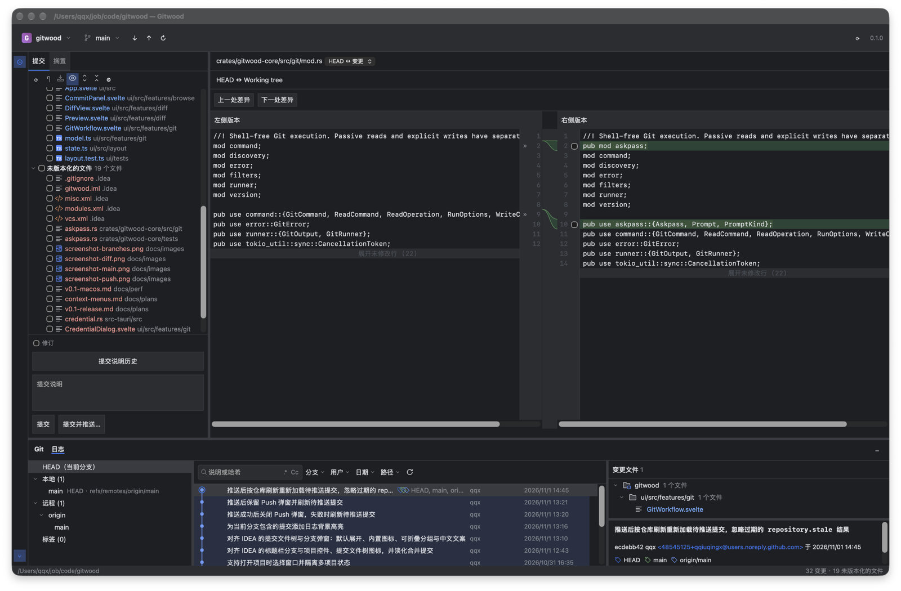
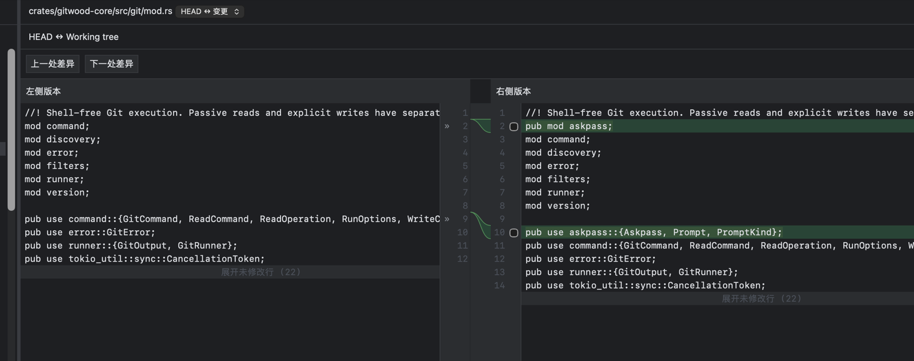
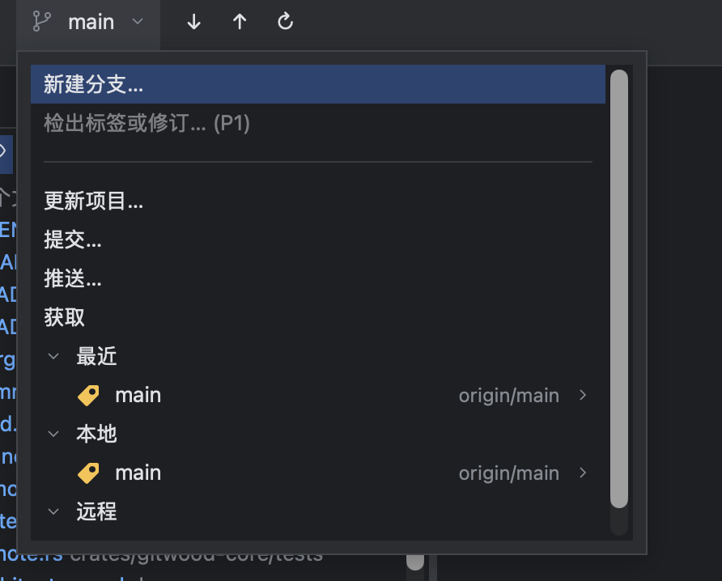
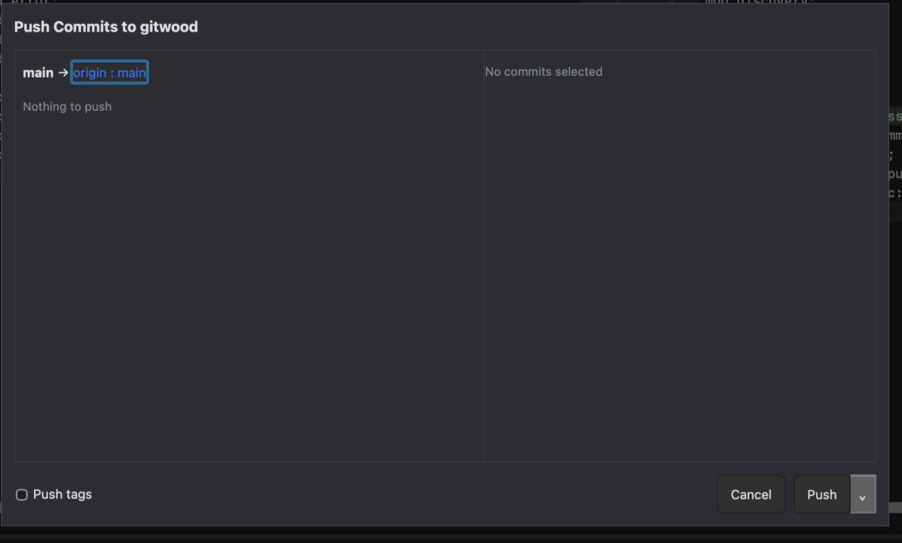

# Gitwood

[简体中文](README.zh-CN.md)

Gitwood is an open-source, cross-platform Git client built with Rust, Tauri 2,
Svelte 5, and TypeScript. Its interaction design references IntelliJ IDEA.
Gitwood uses its own name and original icon; it is an independent project.
No telemetry or usage data is collected.

**Status: v0.2 in development (verified on macOS).** On top of v0.1 (local
repositories, history and double-pane diff, partial commits and Amend, the
IDEA-style branch popup, Fetch / Update / Push, in-app Git/SSH credential
prompts), v0.2 adds conflict resolution with a three-way merge editor; Merge,
Rebase and Pull dialogs; Cherry-pick, Revert, Reset and tags; Stash; file
history and Annotate (Blame); the full native Git menu with the VCS Operations
popup (⌃V); user themes with hot reload; and GitHub / GitLab browser links.
See the [changelog](CHANGELOG.md). Windows and Linux code paths exist but are not
yet runtime-verified; the three-platform CI is deferred to v0.3.

### Known limitations

- Gitwood never stores credentials it asks for; whether they are remembered is
  decided by the system Git credential helper (macOS Keychain, etc.).
- GitHub / GitLab support only opens and copies browser links; no API token,
  pull-request list, or Gist features.
- Windows and Linux have not been runtime-verified.
- macOS artifacts are ad-hoc signed and not notarized (see below).

User themes are JSON files in `~/Library/Application Support/Gitwood/Themes/`
(macOS); see [themes](docs/themes.md) and the [theme schema](docs/theme-schema.json).

## Screenshots









## Build from source

Install Rust stable through rustup, Node.js 24 LTS, and pnpm 12.16.1.
The local development toolchain also supports Node 25.6.1.
On macOS install Xcode Command Line Tools (`xcode-select --install`).
On Windows install Visual Studio C++ Build Tools and WebView2. On Ubuntu 22.04:

```sh
sudo apt update
sudo apt install build-essential curl wget file libwebkit2gtk-4.1-dev \
  libssl-dev libxdo-dev libayatana-appindicator3-dev librsvg2-dev
```

See the [official Tauri prerequisites](https://v2.tauri.app/start/prerequisites/)
for platform setup. Target systems: macOS 13+, Windows 10 1809+, Ubuntu 22.04 or
equivalent with webkit2gtk-4.1. Minimum-system compatibility is not yet verified.

Run from the repository root:

```sh
source ~/.cargo/env # macOS / Linux, if Rust is not on PATH
pnpm install --frozen-lockfile
pnpm tauri dev
```

Create a release-mode application bundle for the current macOS architecture:

```sh
pnpm tauri build
# target/release/bundle/macos/Gitwood.app
```

The default bundle target is `app`; Windows/Linux compilation can use
`pnpm tauri build --no-bundle`. To create a macOS universal DMG:

```sh
rustup target add aarch64-apple-darwin x86_64-apple-darwin
pnpm tauri build --target universal-apple-darwin --bundles dmg
```

macOS bundles are ad-hoc signed, without notarization. On first open a downloaded
build may be blocked: choose System Settings → Privacy & Security → Open Anyway,
or clear the quarantine attribute:

```sh
xattr -d com.apple.quarantine /Applications/Gitwood.app
```

The tag workflow uploads a universal DMG and SHA-256 as workflow artifacts;
publishing a GitHub Release remains a manual, maintainer-approved action.

## Checks

```sh
cargo fmt --all --check
cargo clippy --workspace --all-targets -- -D warnings
cargo test --workspace
pnpm -C ui check
pnpm -C ui test
pnpm tauri build
```

`cargo test` and Clippy also compile the desktop adapter. Production builds need
the frontend assets; `pnpm tauri build` builds those automatically.

See the [implementation plan](docs/implementation-plan.md),
[architecture](docs/architecture.md), [security rules](SECURITY.md), and
[contribution guide](CONTRIBUTING.md). The core runner requires Git 2.35.2 or newer;
the [E2E strategy](docs/architecture.md#e2e-strategy) uses native WebDriver on Windows/Linux and manual native acceptance on macOS. On Windows, install
[Git for Windows](https://gitforwindows.org/).

## License

[Apache-2.0](LICENSE). See [NOTICE](NOTICE) and the
[dependency license inventory](docs/third-party-licenses.md).
