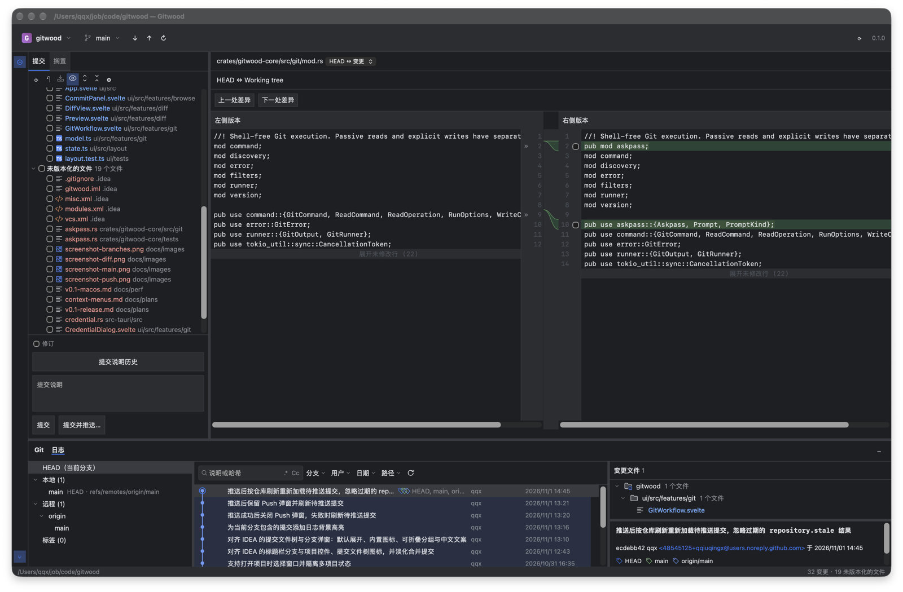
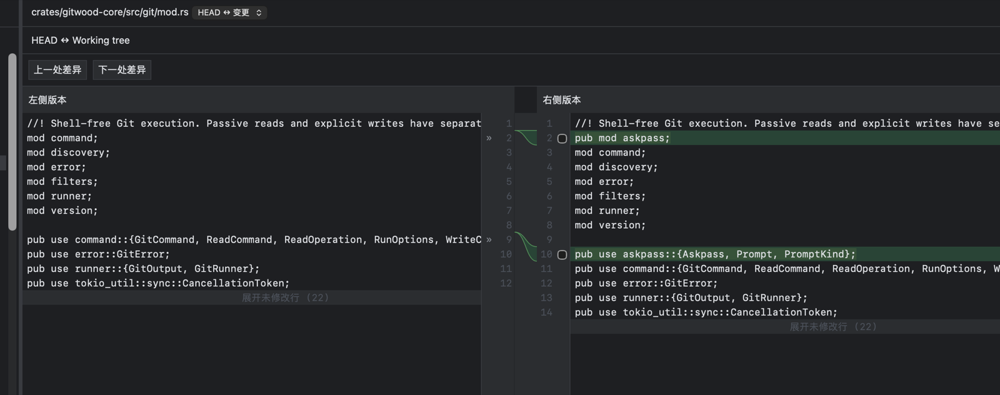
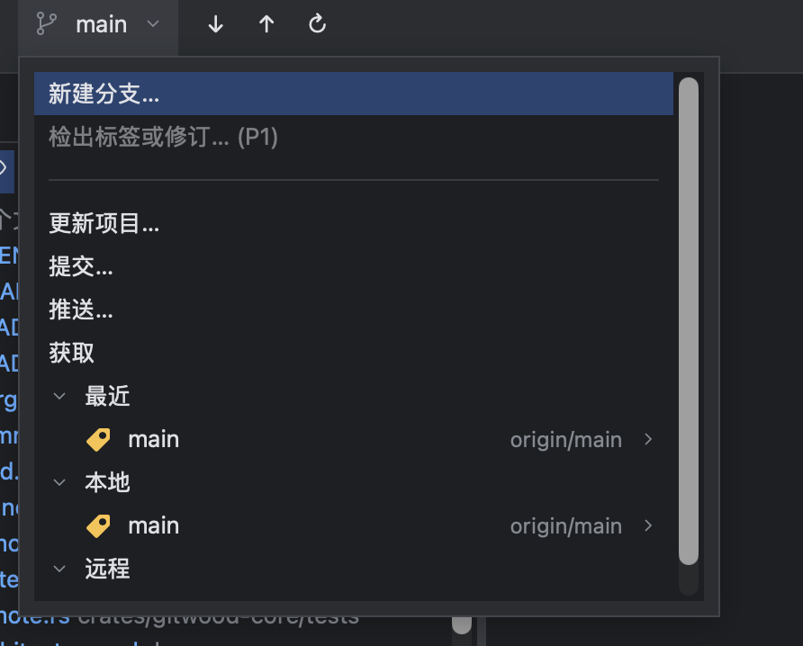
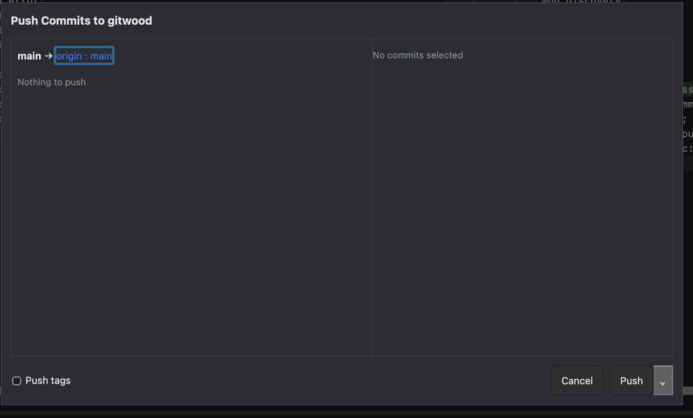

# Gitwood

[English](README.md)

Gitwood 是使用 Rust、Tauri 2、Svelte 5 和 TypeScript 构建的跨平台开源 Git
客户端，交互参考 IntelliJ IDEA。项目使用自有名称和原创图标，独立开发，
不收集遥测或使用数据。

**状态：v0.1（macOS）。** 应用可以打开本地仓库、浏览历史与双栏 Diff、提交选中变更
（含差异块选择与 Amend），使用 IDEA 风格分支弹窗完成新建/检出/重命名/删除，执行
Fetch、Update、Push，并在需要时于应用窗口内弹出 Git/SSH 凭据输入框。v0.1 只面向
macOS；Windows 和 Linux 从 v0.2 起，三平台 CI 推迟到 v0.3。

### 已知限制

- Gitwood 不保存它所询问的凭据；是否记住由系统的 Git 凭据助手（如 macOS 钥匙串）决定。
- 冲突解决待 v0.2。
- Windows/Linux 从 v0.2 起，尚未运行时验证。
- macOS 使用 ad-hoc 签名、不做公证（见下文）。

## 截图









## 从源码构建

准备 Rust stable（rustup）、Node.js 24 LTS、pnpm 12.16.1；本地工具链也支持
Node 25.6.1。macOS 安装 Xcode Command Line Tools（`xcode-select --install`）；
Windows 安装 Visual Studio C++ Build Tools 和 WebView2；Ubuntu 22.04 安装：

```sh
sudo apt update
sudo apt install build-essential curl wget file libwebkit2gtk-4.1-dev \
  libssl-dev libxdo-dev libayatana-appindicator3-dev librsvg2-dev
```

其他平台安装细节见 [Tauri 官方前置依赖](https://v2.tauri.app/start/prerequisites/)。
目标系统为 macOS 13+、Windows 10 1809+、Ubuntu 22.04 或具备 webkit2gtk-4.1 的
同等发行版；最低系统版本兼容性尚未验证。

在仓库根目录运行：

```sh
source ~/.cargo/env # macOS / Linux 中 Rust 不在 PATH 时执行
pnpm install --frozen-lockfile
pnpm tauri dev
```

构建当前 macOS 架构的 release 应用：

```sh
pnpm tauri build
# target/release/bundle/macos/Gitwood.app
```

默认只生成 `app`。Windows/Linux 可用 `pnpm tauri build --no-bundle` 验证编译。
构建 macOS universal DMG：

```sh
rustup target add aarch64-apple-darwin x86_64-apple-darwin
pnpm tauri build --target universal-apple-darwin --bundles dmg
```

macOS 使用 ad-hoc 签名，不做公证。首次打开下载的安装包时系统可能阻止，请到
“系统设置 → 隐私与安全性”选择“仍要打开”，或清除隔离属性：

```sh
xattr -d com.apple.quarantine /Applications/Gitwood.app
```

tag 工作流只上传 universal DMG 和 SHA-256 到工作流产物，公开发布 GitHub Release
仍由维护者确认后执行。

## 验证命令

```sh
cargo fmt --all --check
cargo clippy --workspace --all-targets -- -D warnings
cargo test --workspace
pnpm -C ui check
pnpm -C ui test
pnpm tauri build
```

Clippy 和 `cargo test` 同时编译桌面适配层。生产构建需要前端资源，
`pnpm tauri build` 会自动先构建前端。

详见[实施计划](docs/implementation-plan.md)、[架构](docs/architecture.md)、
[安全规则](SECURITY.md)和[贡献指南](CONTRIBUTING.md)。核心 GitRunner 要求
Git 2.35.2 及以上；[E2E 方案](docs/architecture.md#e2e-strategy)采用 Windows/Linux 原生 WebDriver，macOS 采用真实应用人工验收。核心已包含
GitRunner 和临时 index 部分提交验证，尚未接入桌面界面。Windows 使用
[Git for Windows](https://gitforwindows.org/)。

## 许可证

[Apache-2.0](LICENSE)。第三方信息见 [NOTICE](NOTICE) 和
[依赖许可证清单](docs/third-party-licenses.md)。
